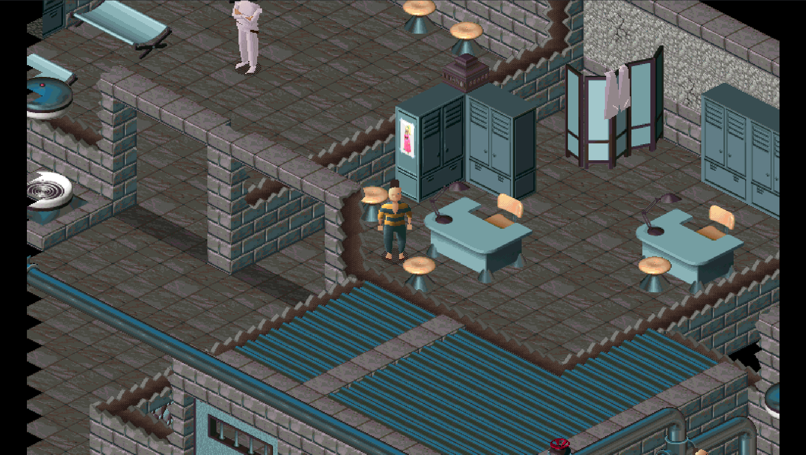

# lba-hle

Little Big Adventure (1994) running on [dos-hle-kit](https://github.com/mitigd/dos-hle-kit).
The original `lba.exe` executes on a virtual CPU; only the functions that touch hardware are
replaced with native code. Game logic, renderers and data stay in the original binary.

<p align="center">
  
</p>

## Status

The port currently gets through the intro, the menus and the isometric rooms with keyboard
control, music, speech and sound effects. What is native so far:

- Video: palette, VESA mode setup, banked screen presents, retrace pacing
- Input: the keyboard ISR body and the BIOS key reader
- Sound: the Miles AIL music API (XMIDI to a host General MIDI synth), the wave driver stub
  table (a software mixer on the host audio sink), and the MSCDEX CD calls (no disc)
- Timing: the 50 Hz PIT timer and the AIL timer services
- Settings: the `LBA.CFG` reader, replaced by the port's `config.ini`
- Extras: widescreen side strips, direct arrow-key controls, save anywhere

Not done yet:

- No game code has been moved to `src/decompiled/`; everything except the seams is still guest
  code
- Direct controls have not been fully vetted.

## Requirements

- Linux with `/dev/kvm` (the default CPU backend is KVM; `--cpu jit` is a portable alternative)
- C++20 and C11 compilers, Meson, Ninja
- SDL2, zlib
- Optional: FluidSynth and a SoundFont (`.sf2`) for music
- The original DOS release of Little Big Adventure: `lba.exe` and its data files. No game data
  is included in this repository.

On Debian/Ubuntu:

```bash
sudo apt install build-essential meson ninja-build libsdl2-dev zlib1g-dev libfluidsynth-dev
```

## Build

The kit is a git submodule at `subprojects/dos-hle-kit`. Clone with submodules, or fetch it in an
existing checkout:

```bash
git clone --recurse-submodules <repo-url>
git submodule update --init --recursive   # in an existing checkout
```

Then build:

```bash
meson setup build
ninja -C build
```

## Run

```bash
build/lba-hle --game /path/to/lba
```

The game directory is searched in this order: `--game DIR` (or an `lba.exe` path on the command
line), `$HLEKIT_GAME_DIR`, the directory remembered from the last start, then next to the
program. A directory only counts if it contains `lba.exe`.

The game directory is treated as read only. Generated files (`lba.cfg`) and saved games go to
the overlay, by default `~/.local/share/hlekit/little-big-adventure/overlay`. Use `--overlay DIR`
to change it.

Useful options:

```text
--seams                 print the seam table and exit
--set key=value         override one config.ini option for this run
--soundfont FILE.sf2    SoundFont for music
--no-seam NAME|AREA     disable one seam or a whole area (video, input, sound, timing)
--headless --seconds N  run without a window
--png FILE --wav FILE   capture the last frame and the mixed audio
--keys SPEC             scripted input, e.g. "1.5:enter,3:down+2.5"
--cpu kvm|jit           choose the CPU backend
```

`--help` lists everything.

## Configuration

Options live in `config.ini` in the per-user directory
(`~/.local/share/hlekit/little-big-adventure/config.ini` on Linux). The file is written with
defaults and comments on first start.

| Key | Default | Values | Meaning |
| :-- | :-- | :-- | :-- |
| `language` | `English` | English, French, German, Spanish, Italian | Text language |
| `voice_language` | `English` | English, French, German, None | Spoken language (`.VOX` files) |
| `keep_voice` | `OFF` | ON, OFF | Let a voice line finish before the next one |
| `display_text` | `ON` | ON, OFF | Show dialogue text |
| `soundfont` | empty | path | SoundFont for music; also `--soundfont`, `$HLEKIT_SOUNDFONT` |
| `widescreen` | `off` | off, 16:9, 16:10, 21:9 | Widen the room view |
| `controls` | `classic` | classic, direct | Tank controls or arrow-key movement |
| `save_anywhere` | `on` | on, off | F9 or Ctrl+S saves where Twinsen stands |

The original has no mouse or gamepad control, and the port does not add any: input is keyboard
only. The unused mouse and pad callbacks in `src/seams/input.cpp` are template leftovers.

## Controls

- `classic`: the original tank scheme. Left/Right turn, Up walks, Down walks backward. Other
  keys (inventory, talk, action) are unchanged.
- `direct`: the arrows name a screen direction. The port turns Twinsen toward it with the game's
  own rotation and then hands a plain Up to the game, so walking, running, collisions and
  animations are the original code.
- F9 or Ctrl+S: save where Twinsen stands (only while the player controls him). A short message
  is drawn on the host picture.
- Escape: skip the intro sequence that plays after loading a save.

## Widescreen

The game still renders 640x480 and the UI stays centered. For the isometric rooms, the port
draws the brick grid a second time with the brick origin shifted, takes the columns beyond each
edge, and presents the result at the requested aspect ratio. The extra passes run between a
snapshot and its restore, so the game's own state is unaffected. Full-screen pictures (holomap,
story screens, main menu) are pillarboxed.

## How a seam works

A seam is a function entry in the original executable that is replaced by a trap. When the guest
calls it, the kit runs a native body and then performs the original return (`ret` or `ret N`).
The guest CPU keeps executing the original instructions around it.

The seam table is built from `docs/seam-candidates.md`, which is generated from the executable
by the kit's analysis tools, and each entry exists because of evidence in the function body or
its call sites. Run with `--seams` to see the table, including the decomp evidence stored with
each seam. The kit reports any hardware access that still reaches the guest CPU as
`[hw] unseamed hardware access`; that report is the work list.

Do not emulate devices. A seam that used to program the VGA DAC, the PIT or a sound card now
calls host services (palette, frames, host clock, host input, audio queue).

## Layout

```text
src/
  game.cpp        GameInfo, module wiring, generated LBA.CFG
  seams/          native seam modules by area + All()
                  video, input, sound, timing, settings, music, samples,
                  widescreen, controls, savegame
  decompiled/     translated game code (empty for now, see its README)

docs/
  project.md         project notes and feature details
  seam-candidates.md hardware-touching functions, generated from lba.exe
  ranked-seams.md    candidates ranked by replacement value
  functions.csv      Ghidra function labels (address,name,size)
```

To add a seam, write a module in `src/seams/`, list it in `meson.build`, and concatenate its
vector in `seams::All()`. To replace game code, put the translated function in
`src/decompiled/` and call the original through `Machine::CallGuest`/`CallGuestFar` until the
module is complete.

## Notes

- Music needs a SoundFont. Without one the port runs silently but the game still sees sequences
  start, loop and finish.
- There is no CD audio. The MSCDEX seams report no drive, which is the original's own
  "not found" path; the music player then falls back to MIDI.
- Sample playback is a native mixer, not an emulated Sound Blaster. The 18 wave driver stubs
  were translated from the semantics of `w_sb16.dll`.
- The room loop is paced to 70 Hz. Idle key waits are paced too, so menus do not spin the host
  CPU.
- The kit supports KVM on Linux; the `jit` backend is portable but experimental.

## Documentation

- [docs/project.md](docs/project.md): feature details, addresses and the design of each module
- [src/decompiled/README.md](src/decompiled/README.md): how the decomp area is meant to grow
- [dos-hle-kit README](subprojects/dos-hle-kit/README.md): the framework, the seam API, the
  analysis tools and the runner options

Little Big Adventure is a game by Adeline Software International. This project contains no game
assets and is not affiliated with the rights holders.
